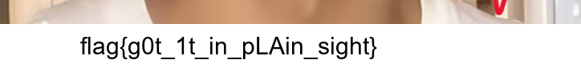

# BYTE Cybersecurity — Cryptography and Steganography

This repository covers the two BYTE cybersecurity challenges I attempted: cryptography and steganography. I've included the Python scripts, the challenge images, and a short explanation of how the results were obtained.

## Results

| Challenge | Result | Status |
| --- | --- | --- |
| Cryptography | `BYTE{bY73_L8A_ChuKA_B4dLaV}` | Possible answer |
| Steganography | `flag{g0t_1t_in_pLAin_sight}` | Recovered from the repaired image |

## Task 01 — Cryptography

The challenge started with this string:

```
QkFJTntiQTczX1E4Ul9BcmhIQ19YNHlHY0R9
```

I started with Base64 decoding, which gave:

```
BAIN{bA73_Q8R_ArhHC_X4yGcD}
```

That wasn't the required `BYTE{...}` format, so Base64 alone wasn't enough. I investigated a second layer using the **Beaufort cipher**. With the expected prefix `BYTE` and the decoded prefix `BAIN`, the corresponding four-letter key would be `CYBR` (using `K = (P + C) mod 26`, where A = 0).

Applying Beaufort with that repeating key to letters only gives:

```
BYTE{bY73_L8A_ChuKA_B4dLaV}
```

The script reproduces that output and reverses it back to the Base64 result. **This remains a candidate:** the key was derived from the expected prefix, so matching that prefix is not independent proof that it is the intended answer.

To run the decoder:

```bash
python decode_and_audit.py
```

The key calculation is in [analysis.md](analysis.md).

## Task 02 — Steganography

The provided PNG displayed only part of the picture. Checking its structure showed two issues:

- The header reported **800 pixels** in height, but its saved CRC was consistent with **850 pixels**.
- There was an extra `IEND` marker before the actual end of the file.

The repair script removes the extra marker and fixes the height. The restored image is **724 × 850 pixels**, and the previously hidden bottom section contains:

```
flag{g0t_1t_in_pLAin_sight}
```

To reproduce the repair:

```bash
python -m pip install -r requirements.txt
python repair_png.py
```

You can compare the [original image](challenge_corrupted.png), the [repaired image](challenge_repaired.png), and the [flag close-up](recovered_flag_crop.png).



## Tools

Python (`base64`, `struct`, `zlib`) and Pillow were used to decode the text and repair the PNG. I also used ChatGPT for investigating approaches, debugging scripts, and polishing the explanation.

[Original BYTE challenge](https://bytesoc.dev/tasks/cybersecurity/)
